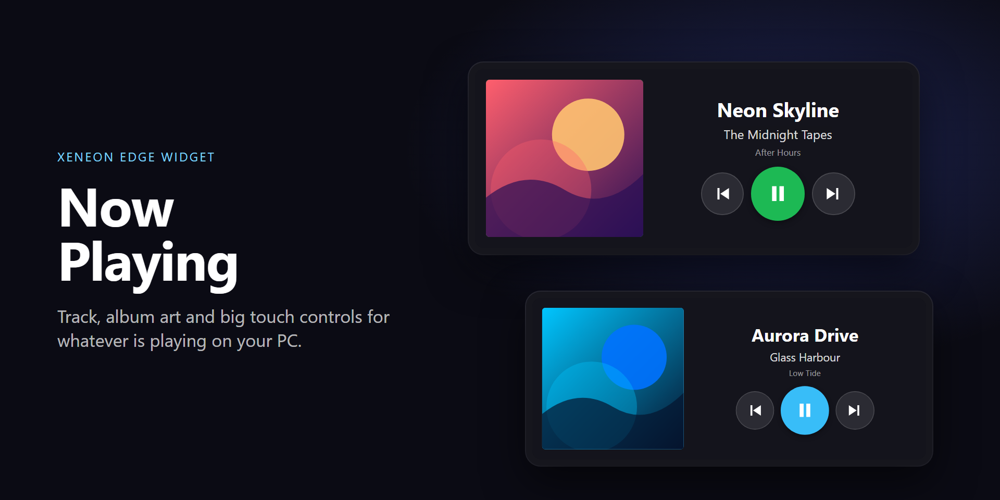

# iCUE Widgets for XENEON EDGE

Custom HTML widgets for the Corsair XENEON EDGE touchscreen, built with the iCUE Widget API.

| Widget | Version | What it does | Size |
|---|---|---|---|
| [Now Playing](#now-playing) | 1.0.4 | Current track, album art and touch media controls for any app | Small, Medium, Large, XL |
| [Player for Spotify](#player-for-spotify) | 0.4.4 | Full-screen Spotify library, queue and now playing | **Extra Large only** |

## Contents
- [Requirements](#requirements)
- [Build and install](#build-and-install)
- [Now Playing](#now-playing)
- [Player for Spotify](#player-for-spotify)
  - [What you need](#what-you-need)
  - [Setup, step by step](#setup-step-by-step)
  - [Using it](#using-it)
  - [Troubleshooting](#troubleshooting)
  - [Permissions and privacy](#permissions-and-privacy)
  - [Limitations](#limitations)
- [Development](#development)
- [Documentation](#documentation)

## Requirements
- A XENEON EDGE and iCUE 5 on Windows (Now Playing: iCUE 5.44 or later; Player for Spotify: iCUE 5.52 or later)
- [Node.js](https://nodejs.org/), only to build the packages yourself

## Build and install
```bash
npm install -g icuewidget-cli
icuewidget validate widgets/now-playing
icuewidget package widgets/now-playing
icuewidget validate widgets/spotify-library
icuewidget package widgets/spotify-library
```
`icuewidget package` writes `now-playing.icuewidget` and `player-for-spotify.icuewidget` into the `widgets/` folder (next to the widget folders). In iCUE open **Widgets**, click **+** and select the file, or double-click it.

**Updating a widget:** if you import a newer package over a widget that is already on an Edge page, iCUE keeps the old placement and size. If sizes or layout look wrong after an update, remove the widget from the page and add it again.

---

## Now Playing


- Title, artist and album, with album art that crossfades between tracks (a colour tile when there is no art)
- Previous, play/pause and next touch buttons, dimmed when nothing is playing
- Custom text, accent and background colours
- Responsive layout: side by side on wide slots (Small, Large, XL) and stacked on squarer slots (Medium)
- Works with anything that appears in Windows media controls (Spotify, Apple Music, browsers and so on) through iCUE's Media Data Provider, so **no account or setup is needed**

---

## Player for Spotify
A full-screen Spotify companion for the Edge, in three panes:

- **Library:** your playlists and the artists you follow, most recently played first. Tap a playlist to see its songs with artwork, tap an artist to see their popular songs, and tap a song to play it. A **Play** button plays the whole playlist or artist.
- **Up next:** your current queue. Tap a song to play it straight away.
- **Now playing:** artwork, title, artist, progress, and previous, play/pause and next.

It is designed for the **Extra Large (full screen) slot only**. In a smaller slot it shows a message asking for the full screen, along with the size it was given.

### What you need
- **Spotify Premium.** Spotify requires it for playback control, and for the account that owns a developer app.
- **The Spotify desktop app** running on the same PC. The widget controls it; it doesn't play audio itself.
- **Your own free Spotify developer app** (a "Client ID"). Spotify limits apps in development mode to 5 users, so a shared app isn't practical. Everyone who uses the widget creates their own.
- **Your own sign-in page.** Spotify only redirects to an HTTPS address you register. This repository includes a tiny static page (`docs/callback/index.html`) whose only job is to show you the code Spotify sends back. You host a copy of it yourself (step 1 below). It's free and takes a few minutes.

### Setup, step by step

#### 1. Host your own callback page
The page must be on HTTPS at an address you control. The simplest way is GitHub Pages:

**Option A: fork this repository**
1. Fork this repository on GitHub.
2. In your fork, open **Settings > Pages**.
3. Set **Source** to *Deploy from a branch*, choose branch `main` and folder `/docs`, then **Save**.
4. After a minute your page is live at:
   ```
   https://<your-github-username>.github.io/<your-repo-name>/callback/
   ```
   Keep the trailing slash. Open it in a browser: you should see "Nothing to copy". That means it works.

**Option B: any other static host**
Copy `docs/callback/index.html` to any HTTPS static host (Netlify, Cloudflare Pages, your own site) and note its address. If your host serves it without a trailing slash, use that exact address everywhere below.

The page runs entirely in your browser. It reads the code from the address bar, shows it with a Copy button, and sends it nowhere.

#### 2. Create the Spotify app
1. Go to the [Spotify developer dashboard](https://developer.spotify.com/dashboard) and log in with your Premium account.
2. Click **Create app**.
3. Give it any name and description. Don't put "Spotify" in the name.
4. **Redirect URI:** paste your callback address from step 1 exactly as it will appear in the widget, then click **Add**.
5. Under **Which API/SDKs are you planning to use?** tick **Web API**.
6. Accept the terms and **Save**.
7. Open the app's **Settings** and copy the **Client ID**.
8. Under **User management**, add the Spotify email of anyone else who will use your app (you are included automatically).

#### 3. Add the widget in iCUE
1. Build and import the package (see [Build and install](#build-and-install)).
2. Add **Player for Spotify** to your Edge, and choose the **XL** size in its settings. XL takes the whole page, so use a page with no other widgets.
3. Open the widget's settings and fill in **Spotify connection**:
   - **Spotify Client ID:** the ID from step 2.
   - **Redirect page URL:** the exact callback address you registered in step 2.

#### 4. Connect
1. On the Edge, tap **Connect**. Your normal browser opens Spotify's approval page. Click **Agree**.
2. You land on your callback page. Click **Copy code**.
3. In iCUE, paste the code into **Paste code here** in the widget's settings.
4. The widget signs in and loads your library. It stays signed in and renews its access automatically.
5. Start Spotify on your PC and play something once, so the widget has a device to control.

Codes are single use and expire within minutes. If sign-in fails, tap **Connect** again and use the fresh code.

### Using it
- **Library order:** the most recently played playlists and artists come first, then Spotify's own order. Spotify doesn't tell apps which items you've pinned, so pins can't be mirrored. As a workaround, the optional **Pinned playlists** setting takes playlist or artist names separated by commas and shows them first, in that order.
- **Songs in a playlist:** tap one to play it from there; the rest of the playlist follows.
- **Playlists you follow but don't own** may show **Play only**: Spotify only lets developer apps read the songs of playlists you own or collaborate on, but you can still press **Play**.
- **Artists:** Spotify no longer gives apps an artist's top tracks, so the widget searches Spotify for that artist's songs. Tap a song to play it inside its album, or press **Play** to play the artist.
- **Up next:** tap a queued song and it plays straight away. Spotify has no "play this queue entry" call, so the widget starts that song inside the playlist or album it came from (a song you queued yourself plays in its own album). The queue then continues from there, so it is rebuilt from that playlist or album rather than your old queue.
- **Appearance:** text, accent and background colours, and background transparency, in the widget's settings.

### Troubleshooting
| What you see | What to do |
|---|---|
| "needs the full screen" and a slot size | The widget only supports the XL slot. Set the size to XL on an empty Edge page. If XL won't select after an update, remove the widget from the page and add it again. |
| Sign-in fails or "invalid redirect" | The redirect address in the Spotify dashboard and in the widget must match exactly, including `https` and any trailing slash. Get a fresh code by tapping **Connect** again. |
| "Reconnect for artists and recents" in the library header | The widget now needs an extra Spotify permission. Tap it, approve in your browser and paste the new code. This happens after updates that add permissions. |
| "Spotify didn't start that song" | Spotify ignored the request, usually because nothing is active yet. Press play in the Spotify desktop app, then tap the song again. |
| "No active device" or nothing playing | Start the Spotify desktop app on this PC and play a song once. |
| "Playback control needs Spotify Premium" | Controls need Premium; browsing works without it. |
| Library missing items | Liked Songs, albums and Spotify-generated playlists (such as Release Radar or Blend) aren't provided to developer apps. |
| "Can't reach Spotify" | The network is down, or you revoked a permission for the widget in iCUE's widget settings. It keeps showing the last known track and recovers by itself. |
| Controls stop working briefly | Spotify rate-limits developer apps. The widget backs off and retries by itself. |

### Permissions and privacy
iCUE shows these permissions when you install the widget, and you can revoke them in the widget's settings at any time.

| Permission | Scope | Why |
|---|---|---|
| `url` | `api.spotify.com` | Read your playlists, followed artists, queue and playback state, and send play, pause and skip commands |
| `url` | `accounts.spotify.com` | Sign in and renew your access |
| `url` | `scdn.co`, `spotifycdn.com` | Load album, playlist and artist artwork from Spotify's image servers |

The widget asks Spotify for these scopes: `playlist-read-private`, `user-read-playback-state`, `user-read-currently-playing`, `user-modify-playback-state`, `user-read-recently-played` and `user-follow-read`. It sends nothing to any service except Spotify, and never to your callback page.

Your Spotify sign-in token is kept in iCUE's local storage for this widget on your PC, together with a list of recently played playlist and artist links (for ordering). It also keeps a short log of its last 40 Spotify requests (time, type of request, result and a brief note, never your token) in the same local storage, to help diagnose problems. Your Client ID and the pasted code are stored by iCUE with the widget's settings. To sign out, remove the widget and revoke the app at [spotify.com/account/apps](https://www.spotify.com/account/apps/).

### Limitations
- **Extra Large slot only**, Windows only.
- Spotify's development mode allows up to 5 users per app and needs a Premium owner. This is a "bring your own Client ID" widget, not a shared service.
- Music only: podcast episodes are ignored. No Liked Songs, albums, search, or adding to the queue.
- Pinned items in Spotify's own library can't be read by apps.
- The Spotify attribution is a plain text "Play on Spotify" link.

---

## Development
```
widgets/
  now-playing/        manifest.json, index.html, style.css, app.js, resources/
  spotify-library/    Player for Spotify: manifest.json, index.html, style.css, app.js, js/, resources/
docs/
  callback/           the static sign-in page you host (see setup step 1)
publish/              Marketplace listing images (1920x960 PNG)
```
- **Preview without iCUE or Spotify:** open `widgets/spotify-library/index.html?mock=1` in a browser at 2536 x 696. Add `&open=p1` for a playlist, `&open=a1` for an artist, `&paused=1` for the paused state, or `&pinned=Focus` to test pinned names.
- **Listing images:** `node publish/build.mjs` renders the thumbnail and gallery images from the real widget with mock data (needs Edge or Chrome).
- **Checks:** `icuewidget validate widgets/<name>` checks the manifest, head markup and the declared permissions against the code.

## Documentation
- [iCUE Widgets docs](https://docs.elgato.com/icue/widgets/)
- [Media Data Provider plugin](https://docs.elgato.com/icue/widgets/references/plugins/media-data-provider)
- [How to create a custom widget for the XENEON EDGE](https://www.corsair.com/uk/en/explorer/diy-builder/accessories/how-to-create-a-custom-widget-for-the-xeneon-edge/)
- [Spotify Web API](https://developer.spotify.com/documentation/web-api) and its [design guidelines](https://developer.spotify.com/documentation/design)

## Notes
These are independent projects written from the public iCUE and Spotify documentation. They are not affiliated with or endorsed by Corsair, Elgato or Spotify. Spotify is a trademark of Spotify AB.
